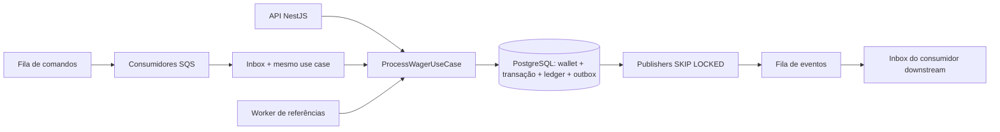

# Decisões de arquitetura

## Objetivo e limites

Priorizei invariantes financeiras verificáveis em PostgreSQL, recuperação após falhas e testes com processos reais. O serviço é um backend de desafio técnico, sem frontend, pagamentos reais, Identity Provider ou promessa de prontidão operacional para produção. O contrato de referência está em `spec.md`.

## Componentes

O domínio não depende de NestJS, ORM ou SDK AWS. Portas de aplicação delimitam a transação financeira. Adaptadores usam MikroORM (`EntityManager.transactional`, lock pessimista e schemas explícitos) e SQL parametrizado para inbox, idempotência e outbox. HTTP e SQS chamam o mesmo use case; a entrada SQS injeta a sessão SQL já aberta para incluir a inbox no mesmo commit. Consultas operacionais usam SQL exato, sem converter dinheiro para number.

## Dinheiro e ledger

`Money` usa bigint de centavos, é imutável e aceita strings com escala fixa 2. Não há arredondamento implícito: entrada com mais casas é inválida. A faixa é compatível com numeric(18,2); BRL/USD/EUR são permitidas, sem conversão cambial. PostgreSQL persiste decimal e o driver retorna string. number é usado apenas para versões, contagens, tempos e métricas.

`Wallet` encapsula saldo e versão; abertura começa em 1, inclusive saldo zero. Saldo positivo gera OPENING e CREDIT atômicos. Depois da abertura, versão só aumenta com uma movimentação. LOSS, rejeições e falhas não criam ledger. Ledger é de entrada única, com direção, valor positivo, saldo antes/depois e versão; partidas dobradas ficaram fora do escopo.

Constraints, FKs compostas e índices únicos protegem identidade, valores não negativos, moeda, vínculo financeiro e no máximo uma entrada por transação/wallet. Triggers diferidos conferem saldo agregado, sequência do ledger, efeitos das operações, referências, idempotência e eventos antes do commit. Ledger e transações terminais rejeitam edição/exclusão. A conta runtime não pode apagar/truncar tabelas nem editar lançamentos. O proprietário de migrations é administrativamente privilegiado; proteção contra um DBA malicioso não é uma garantia possível deste desenho.

Trade-off: conferir o histórico completo no commit é simples e forte para o desafio, mas o custo cresce com o ledger de uma wallet. Em grande volume, eu mediria hot wallets e adotaria validação incremental, checkpoints auditáveis e reconciliação periódica, preservando as invariantes.

## Concorrência e idempotência

A ordem de locks é identidade da inbox (quando existe), chave do provedor, ID externo do provedor e finalmente wallet. Os locks de identidade são advisory transacionais, com namespace e hash de 64 bits; a correção final também depende das constraints únicas. Colisões de hash podem reduzir paralelismo, não produzir efeitos duplicados. Não há lock global. A wallet é bloqueada com SELECT FOR UPDATE/MikroORM pessimistic lock, e wallets distintas progridem em paralelo. Timeout de lock: 3s; statement: 10s. Um timeout aborta a transação e permite retry com a mesma identidade.

A idempotência é persistente por `(providerId,idempotencyKey)` e `(providerId,externalTransactionId)`. Chaves diferentes para o mesmo ID externo e mesmo negócio viram aliases. Payload diferente em qualquer uma dessas identidades é conflito.

SHA-256 é calculado sobre JSON canônico do subconjunto de negócio, construído em ordem lexicográfica nas duas camadas: externalTransactionId, gameId, kind, money(amount,currency), playerId, providerId, referenceExternalTransactionId quando presente, roundId, walletId. UUIDs são normalizados para minúsculas; Money normaliza a representação. Header, correlationId, messageId e timestamps de transporte ficam fora do hash. Campos desconhecidos não integram o contrato. A inbox inclui também a chave no seu hash para detectar reutilização divergente do envelope.

A resposta original é persistida e imutável. Replay preserva saldo/status observados naquele instante; `idempotentReplay` passa a true. `current_result` permite consultar o progresso atual de uma referência sem reescrever a resposta originalmente aceita.

## Transições e referências

PENDING existe apenas no domínio durante o processamento. A primeira persistência já é PROCESSED, REJECTED, PENDING_REFERENCE ou FAILED. PENDING_REFERENCE pode permanecer pendente, processar ou rejeitar; estados terminais não mudam. `rehydrate` reconstrói estado sem reaplicar regras de transição.

REFUND referencia BET; ROLLBACK referencia BET/WIN/REFUND. Identidade, moeda, rodada e valor integral precisam coincidir. A unicidade da reversão é **por tipo**, conforme a especificação: a mesma referência pode receber um REFUND e um ROLLBACK; não dois do mesmo tipo. WIN pode não ter referência. LOSS é auditável sem efeito financeiro.

Referência ausente ou ainda pendente não bloqueia a fila: registra PENDING_REFERENCE e confirma o consumo. Worker consulta linhas vencidas com SKIP LOCKED, trava a wallet e aplica a operação quando a referência aparece. TTL padrão 15 minutos, backoff exponencial 1s..60s. Ao expirar, REFERENCE_NOT_FOUND é terminal e gera rejeição. Polling padrão 500ms. O relógio vem do processo; em produção, sincronização de relógios deve ser monitorada.

## Falhas estáveis

| failureCode | Interpretação |
|---|---|
| INSUFFICIENT_BALANCE | Aposta sem saldo |
| REVERSAL_INSUFFICIENT_BALANCE | Compensação de crédito causaria saldo negativo |
| CURRENCY_MISMATCH / PLAYER_MISMATCH | Operação incompatível com a wallet |
| MONEY_OUT_OF_RANGE | Resultado excede numeric(18,2) |
| INVALID_REFERENCE | Referência incompatível ou terminal sem sucesso |
| ALREADY_REVERSED | Reversão do mesmo tipo já aplicada |
| REFERENCE_NOT_FOUND | TTL da referência esgotado |
| INFRASTRUCTURE_RETRIES_EXHAUSTED | Tentativas de infraestrutura esgotadas, FAILED |

INVALID_PAYLOAD, IDEMPOTENCY_CONFLICT e WALLET_ALREADY_EXISTS são erros de contrato/identidade, anteriores a uma nova movimentação. Contratos HTTP estão no README. Erros inesperados de infraestrutura são expostos sem detalhes internos, com 503 e Retry-After; erros permanentes de transporte seguem para DLQ.

## Inbox, retry, DLQ e shutdown

A inbox tem chave `(consumer_name,message_id)`. Inbox, transação, saldo, ledger, aliases e outbox são um único commit. Ack ocorre depois; perder o processo depois do commit causa replay seguro. Mensagens inválidas/conflitantes vão à DLQ sem inventar uma transação financeira válida.

Consumidores fazem long polling, heartbeat de visibilidade a cada 10s e visibility timeout de 30s. Backoff de transporte é exponencial e limitado a 60s, com máximo de 5 recebimentos. O recebimento solicita os atributos nas formas compatíveis com AWS e LocalStack 4.12: `MessageSystemAttributeNames` e `AttributeNames`. O fallback foi necessário para o emulador retornar ApproximateReceiveCount corretamente. Testes reduzem a visibilidade/backoff somente quando o banco é wagering_test.

Na quinta falha, se o banco permite o registro, o mesmo fluxo idempotente persiste FAILED e WagerTransactionFailed, sem ledger, antes da DLQ. Se já houve commit, a auditoria retorna o resultado original e nunca marca dinheiro aplicado como falha. Publicar na DLQ precede apagar a mensagem original; morte nesse intervalo pode duplicar a evidência, não perdê-la. SQS também tem redrive nativo após 5 recebimentos, como proteção durante falha prolongada do banco. Nesse caso o registro SQL de FAILED não é garantido enquanto o banco estiver inacessível: é necessário investigar/reprocessar a DLQ depois da recuperação. FAILED permanece terminal; corrigir negócios exige uma operação nova, não editar histórico.

SIGTERM/SIGINT interrompe novas buscas, conclui o trabalho em andamento e fecha conexões. Se a parada foi solicitada durante a busca, a mensagem recebida tem visibilidade devolvida. A morte forçada depende do timeout de visibilidade e da inbox. Compose permite 45s de encerramento e reinicia processos que falham.

## Outbox e consumidor downstream

Os eventos são subclasses de uma classe abstrata, com envelope versionado, eventId, aggregateId, correlationId, causationId quando disponível e data com MoneyProps. Um evento de resultado por transação e WalletBalanceChanged apenas quando há mudança de saldo. OPENING é interno e não publica os eventos de wagering.

Publishers selecionam uma linha vencida com FOR UPDATE SKIP LOCKED. O lock é mantido durante SendMessage; o SDK tem timeout e tentativas limitados. Sucesso marca published_at; falha agenda backoff persistente. A outbox não descarta eventos por esgotamento: continua tentando com limite de atraso de 60s.

Morte antes do envio deixa a linha pendente; morte depois do envio e antes do marcador pode reenviar. eventId e deduplicationId são estáveis, mas FIFO tem uma janela limitada e não elimina a necessidade de inbox downstream. `consume-event.ts` exemplifica projeção e inbox no mesmo commit, validada com duplicatas concorrentes. Garantia: publicação at-least-once e efeito idempotente no consumidor, não entrega exatamente uma vez. Publishers paralelos podem publicar eventos da mesma wallet fora da ordem de versão; consumidores que projetam saldo devem usar walletVersion ou reconstruir do ledger.

Trade-off: manter conexão/lock durante a chamada externa simplifica recuperação e evita leases órfãos; ocupa uma conexão durante a latência SQS. Em escala maior, leases com fencing e expiração seriam uma evolução, com mais estados a verificar.

## Consulta, reconciliação e observabilidade

Ledger usa paginação por versão, sem OFFSET, cursor Base64URL vinculado à wallet. É opaco, não criptografado nem assinado; só carrega posição, sem segredo, e não substitui autorização. Inserções posteriores não deslocam páginas existentes.

Reconciliação segura o lock da wallet enquanto calcula o total. A resposta inclui saldo armazenado, calculado, diferença e número de entradas. Divergência gera log e contador e não é corrigida automaticamente.

Logs JSON incluem os identificadores disponíveis em cada etapa; mensagens inválidas podem não ter IDs de domínio. Não registram dinheiro, credenciais, headers ou payloads completos. Métricas por processo cobrem resultado, duplicatas, retry, DLQ, conflitos de lock e soma/contagem de latência. A API consulta o lag global de outbox no banco. É necessário coletar todas as réplicas; métricas em memória reiniciam com elas. Dashboard, tracing distribuído e histogramas percentis não foram implementados.

## Autenticação, configuração e entrega

Autenticação não pontua no desafio e foi deliberadamente omitida. `NoopProviderGuard` e `ProviderIdentityPort` são a extensão explícita. Para produção: OIDC de Keycloak/Zitadel ou IdP equivalente, verificação de assinatura/audience/issuer e vínculo entre claim e providerId; autorização também para carteira, consultas e reconciliação. Health permanece público. SQS é canal interno, com IAM separado entre produtores/consumidores; a identidade do payload continua validada no domínio. Não há usuários ou senhas artesanais.

Bun/Nest/MikroORM têm versões fixadas, lockfile e TypeScript strict. `skipLibCheck` ignora incompatibilidades de declarações de terceiros; não desativa a checagem do código da aplicação. Docker usa Bun 1.4.4, PostgreSQL 16.11 e LocalStack 4.12.0. Migrations são explícitas, transacionais e reversíveis onde não há perda de histórico; down inseguro falha.

Credenciais locais são exemplos, não segredos de produção. O ambiente Compose não é uma implantação pública. Backups, TLS, rotação de credenciais, retenção de ledger/inbox, autenticação real, alarmes e ensaio de carga com percentis seriam necessários antes de produção. O LocalStack local não persiste filas em recriações; os testes não alegam durabilidade do emulador equivalente à AWS.

## Evidência verificável

Os testes usam bancos e filas reais em containers, sem substituir toda a infraestrutura por mocks. Há cenários concorrentes, três subprocessos, dois publishers, crash após commit, retries com falhas SQL injetadas, referências fora de ordem, replay após conexão nova e reconciliação final. `scripts/demo.ts` exercita a aplicação Compose inteira por HTTP e SQS. Não há número de throughput divulgado porque não foi executado benchmark controlado.
